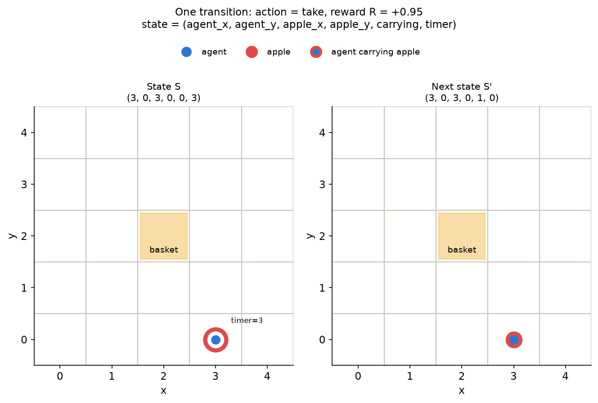
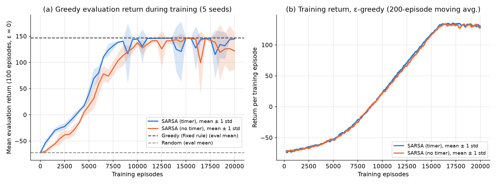
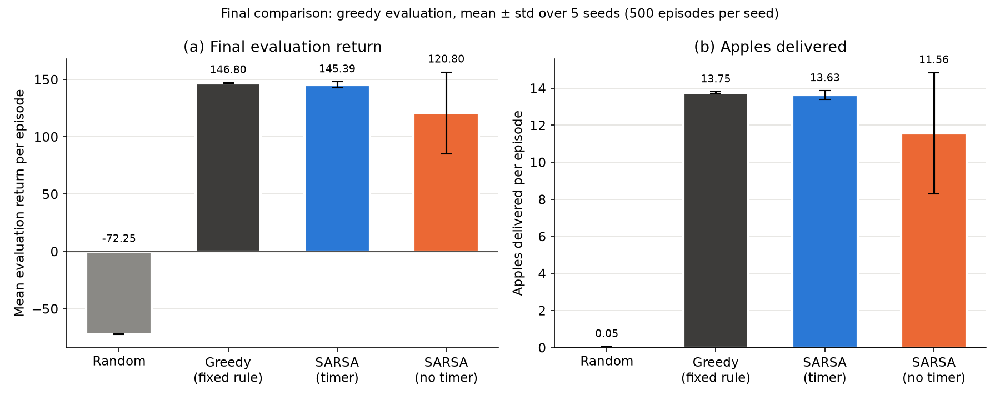
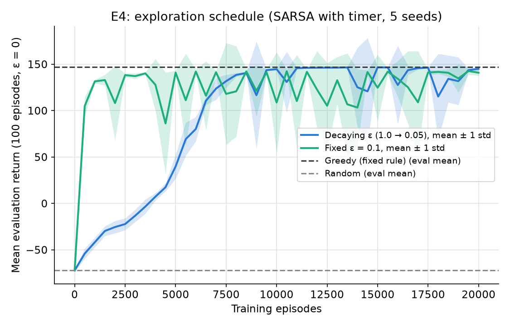

# Apple Collector Gridworld: Learning to Pick and Deliver with Tabular SARSA

**CSCI3235 Reinforcement Learning, Midterm I take-home project**
**Student:** Yergali Ussibaliyev · **Student ID:** TODO · **Date:** 26 October 2026

> Draft notes for the student (delete before export): every number in this report is copied
> from `results/summary.csv`, `results/per_seed.csv`, `results/curve_summary.csv` or
> `results/training_windows.csv`, written by `python run_all.py`. Sections marked
> **[STUDENT]** must be written or rewritten by you.

---

## 1. Problem and RL suitability

**Task (≤ 250 words).** A single agent (the decision-maker) moves on a 5×5 grid. Exactly one
apple exists at any time. The agent must walk to it, pick it up (`take`) and carry it to a
basket in the centre cell (2, 2), then `drop` it there. Each apple has a timer. If the apple
is still on the ground when the timer reaches zero, it rots (−5) and a new apple appears
somewhere else. Every step costs −0.05, a pick-up gives +1 and a delivery gives +10. The
desired outcome is to deliver as many apples as possible in a 100-step episode while letting
none expire.

**Why the decisions are sequential.** The reward for a delivery arrives only after a chain of
correct moves, a `take`, more moves and a `drop`. Where the agent goes now decides whether it
reaches the apple before its timer runs out, and the position at which it delivers decides
where it stands when the next apple spawns. So an action changes future states and future
rewards, not just the immediate reward. Through interaction the agent has to learn which
action is best in each (position, apple position, carrying, timer) situation. It is never
told the shortest path or the meaning of `take`/`drop`; it only receives rewards.

**Non-RL alternative.** A hand-coded rule (our *Greedy* baseline): walk to the apple
(x first, then y), take it, walk to the basket, drop it. In this problem the dynamics are
known, deterministic and simple, so the heuristic is the better engineering choice. It needs
no training and, as section 5 shows, it performs at least as well as the learned policy. RL
becomes useful when the dynamics or rewards are unknown or too complex to hand-code, for
example uncertain apple spawn patterns, obstacles, several competing apples, or costs that
must be traded off against each other.

**Application link [STUDENT: edit this paragraph].** The task is a toy version of produce
picking and placing in agriculture: a robot must collect ripe fruit and bring it to a
collection point before it spoils. The model leaves out real perception, manipulation, many
simultaneous fruits and continuous motion, so it can only illustrate the decision layer.

## 2. MDP formulation

| Element | Definition |
|---|---|
| State | $s = (a_x, a_y, p_x, p_y, c, \tau)$: agent cell, apple cell, carrying flag $c \in \{0,1\}$, apple timer $\tau \in \{0,\dots,11\}$. While carrying, the apple cell equals the agent cell and $\tau = 0$. 5·5·5·5·2·12 = 15 000 encodable states |
| Actions | 6: `up` (y+1), `down` (y−1), `left` (x−1), `right` (x+1), `take`, `drop` |
| Rewards | −0.05 every step; +1 successful `take`; +10 successful `drop` at the basket; −5 when the timer of an apple on the ground reaches 0 |
| Transitions | Moves are deterministic; a move off the grid leaves the agent in place. `take` works only on the apple cell when not carrying; `drop` works only on the basket when carrying (elsewhere it does nothing, which prevents reward farming by repeated pick/drop). After a delivery or an expiry a new apple spawns **uniformly at random** on a cell that is neither the basket nor the agent's cell, with timer = Manhattan distance to the agent + SLACK (SLACK = 3). The timer decreases by 1 after every step while the apple is on the ground and is frozen while it is carried |
| Start | Agent on a uniformly random non-basket cell, not carrying, one apple spawned |
| Horizon | Fixed T = 100 steps (time limit), episodic task |
| Discount | γ = 0.95, effective horizon ≈ 1/(1−γ) = 20 steps. The longest single trip (at most 8 moves to the apple, `take`, at most 4 moves to the basket, `drop`) takes 14 steps, so the delivery reward is still clearly visible from the start of a trip |

**Deterministic or stochastic?** The environment is stochastic: start position and apple
spawns are random, while the movement itself is deterministic. The behaviour policy during
training is stochastic (ε-greedy). The evaluated policy is deterministic (greedy, ε = 0, with
random tie-breaking only between exactly equal action values).

**Markov property.** With the timer included, the state contains everything that determines
the next state and reward except the remaining episode time $t$. That matters only at the
time limit, so the state is Markov apart from that small exception. Without the timer
(ablation E3) the agent cannot tell an urgent apple from a fresh one. Two situations with
different futures (one where the apple will expire, one where it will not) then look
identical, so that state is **not** Markov.

**Worked transition example** (a real `env.step` stored in `results/transition_example.csv`,
drawn in Figure 0):
$S = (3, 0, 3, 0, 0, 3)$: the agent stands on the apple at (3, 0), not carrying, timer 3.
$A$ = `take`. $R = -0.05 + 1 = +0.95$.
$S' = (3, 0, 3, 0, 1, 0)$: now carrying, so the apple position equals the agent position and
the timer is frozen and stored as 0.

*Figure 0. One complete step: state, action, reward and next state.*

## 3. Method and update rule [STUDENT: rewrite in your own words]

We use **SARSA**, an on-policy temporal-difference control method (Sutton & Barto, 2018, §6.4).
For every transition $(S, A, R, S', A')$ the action-value table is updated:

$$Q(S,A) \leftarrow Q(S,A) + \alpha\,\big[\,R + \gamma\,Q(S',A') - Q(S,A)\,\big]$$

- $Q(S,A)$: the current estimate of the expected discounted return when taking action $A$ in
  state $S$ and following the current policy afterwards. It is stored as a numpy array of
  shape (5, 5, 5, 5, 2, 12, 6), initialised to 0.
- $\alpha = 0.1$: the step size, i.e. how far the estimate moves toward the new target.
- $R$: the reward received for this step.
- $\gamma = 0.95$: the discount factor; rewards one step later are worth 95 %.
- $Q(S',A')$: the value of the **next** action $A'$, which the same ε-greedy policy actually
  chose in $S'$. Using the action really taken (instead of the max, as Q-learning would)
  is what makes SARSA on-policy.
- $R + \gamma Q(S',A')$: the **TD target**, a one-step sample of the return.
- $R + \gamma Q(S',A') - Q(S,A)$: the **TD error**, how wrong the current estimate was.

At the end of an episode (t = 100) the target is just $R$ (no bootstrap). The time limit is
not a true terminal state, because the task could go on, so treating it as terminal is a small
approximation. It only affects the last few steps of each episode.

**What is estimated and how it is used.** SARSA estimates the action values of the policy it
follows, the ε-greedy policy. The policy uses them directly: with probability ε a random
action, otherwise $\arg\max_a Q(S,a)$, with ties broken at random. ε decays linearly from 1.0
to 0.05 over the first 80 % of training episodes and then stays at 0.05. As ε shrinks, the
policy improves and the estimates follow it (generalised policy iteration).

**Baselines.** *Random*: a uniformly random action from 6. *Greedy (fixed rule)*: described
in section 1.

## 4. Experimental setup

- **Implementation:** Python 3.12.10, numpy 2.5.4, matplotlib 3.11.2, self-built environment
  (no Gymnasium). Code in `env.py`, `agents.py`, `experiment.py`, `plots.py`, `run_all.py`;
  rule tests in `test_env.py`.
- **Seeds:** 5 independent seeds, 0–4. For seed $s$: training environment $s$, agent
  exploration $s+5000$, evaluation environment $s+10000$ (a separate instance), evaluation
  tie-breaking / random actions $s+20000$. All randomness goes through
  `numpy.random.Generator` objects.
- **Training:** 20 000 episodes × 100 steps per seed and configuration. The episode count is
  justified by the plateau in training return: averaged over seeds, the training return is
  118.95 in episodes 14 001–16 000, 133.70 in 16 001–18 000 and 131.54 in 18 001–20 000
  (`training_windows.csv`). It stops rising once ε reaches its final value at episode 16 000.
- **Evaluation (separate from training):** greedy policy (ε = 0), no Q updates, separate
  environment. E1: 100 evaluation episodes after every 500 training episodes. E2: 500
  evaluation episodes per seed after training. Random and Greedy are evaluated on the same
  evaluation seeds.
- **Metrics per episode:** undiscounted return, apples delivered, apples expired, and whether
  the episode got *stuck* (state unchanged for ≥ 20 consecutive steps; see section 6).
  Reported as mean ± standard deviation (sample std, ddof = 1) across the 5 seed-level means.
- **Experiments:** E1 training curve; E2 final comparison; E3 ablation: timer removed from
  the state (`include_timer=False`), everything else identical; E4 (optional): fixed ε = 0.1
  instead of the decaying schedule.
- **Hardware/runtime:** one process on a Windows 11 desktop (AMD x86-64 CPU). The full run takes
  about 3 min 50 s; each (configuration, seed) training plus evaluation takes 14–16 s
  (`run_info.txt`).
- **Reproduce:** `pip install -r requirements.txt`, then `python run_all.py`. Running it twice
  produced identical `summary.csv` and `per_seed.csv`.

## 5. Results

*Figure 1. (a) Greedy evaluation return during training, mean ± 1 std over 5 seeds, with the
Random and Greedy evaluation means as dashed lines. (b) Return of the ε-greedy training
episodes (200-episode moving average).*

*Figure 2. Final greedy evaluation (500 episodes per seed), mean ± std over 5 seeds.*

**Table 1.** Final evaluation, mean ± std over 5 seed means, 500 evaluation episodes per seed
(`results/summary.csv`).

| Agent | Return | Apples delivered / ep | Apples expired / ep | Stuck episodes |
|---|---|---|---|---|
| Random | −72.25 ± 0.20 | 0.05 ± 0.01 | 13.61 ± 0.04 | 0.0 % |
| Greedy (fixed rule) | 146.80 ± 0.50 | 13.75 ± 0.05 | 0.00 ± 0.00 | 0.0 % |
| **SARSA (timer)** | **145.39 ± 2.61** | 13.63 ± 0.24 | 0.00 ± 0.00 | 0.0 % |
| SARSA (no timer), E3 | 120.80 ± 35.77 | 11.56 ± 3.27 | 0.40 ± 0.46 | 15.5 % |
| SARSA (timer, fixed ε = 0.1), E4 | 141.27 ± 2.63 | 13.25 ± 0.24 | 0.00 ± 0.00 | 0.0 % |

**Observations.**

- SARSA with the timer clearly beats Random (145.39 vs −72.25) and ends close to the Greedy
  rule (146.80). Per seed, its final returns are 140.80, 146.22, 146.04, 147.22 and 146.69
  (`per_seed.csv`). Four seeds match Greedy; seed 0 delivers fewer apples (13.21 vs
  13.75 per episode), but none of its apples expire.
- Learning curve (Fig. 1a, `curve_summary.csv`): the mean evaluation return of SARSA (timer)
  rises from −72.23 before training to 39.80 at 5 000 episodes and first exceeds 140 at
  8 500 episodes (140.51).
- The evaluation curve is not smooth after that. At several checkpoints, one seed's greedy
  policy suddenly drops: e.g. at 14 500 episodes the lowest seed scores 18.00 while the mean
  of the others stays near 146. The next checkpoint recovers.
- E3 (no timer): learning is slower. The mean evaluation return is 17.67 at 5 000 episodes
  (vs 39.80 with the timer) and first exceeds 140 at 11 500 episodes (vs 8 500). At the
  end, apples sometimes expire (0.40 per episode; seed 0: 1.11, seed 2: 0.56), which never
  happens with the timer. The large final std comes mostly from seed 1, which returns 57.54
  because 77.6 % of its evaluation episodes get stuck. The other four no-timer seeds score
  130.09–145.04.
- E4 (fixed ε = 0.1, Fig. 3): learning is much faster at first. The mean evaluation return is
  already 131.48 after 1 000 episodes. However, the training return levels off at about 113
  (`training_windows.csv`), compared with about 132 for the decaying schedule, and the final
  greedy return is slightly lower (141.27 ± 2.63 vs 145.39 ± 2.61).

*Figure 3. E4: decaying vs fixed ε, greedy evaluation return during training (5 seeds).*

## 6. Discussion, limitations and next step

**E3: why removing the timer hurts, and why only a little.** Without the timer the state is not
Markov: one table entry stands for both "fresh apple" and "apple about to rot". Its Q-value
is an average over those situations, so the estimates are noisier and learning is slower
(8 500 vs 11 500 episodes to reach a mean of 140). The agent also cannot see when an apple is
urgent, which is consistent with the 0.40 expired apples per episode against 0.00 with the
timer. The effect is smaller than the Markov argument alone suggests, though. With SLACK = 3
every apple can be reached in time by walking straight to it. The Greedy rule ignores the
timer completely and still never loses an apple. So the best policy does not really *need*
the timer here; the timer mainly helps value estimation. At 15 000 episodes both
configurations reach the same mean evaluation return (146.51 without the timer, 146.54 with it). We expect the
timer to matter much more with a tighter SLACK (e.g. SLACK = 1), where some apples cannot be
saved and the agent must decide which are worth chasing. That experiment was **not run**.

**E4: exploration.** With fixed ε = 0.1 the agent exploits early. It learns a good greedy
policy in about 1 000 episodes instead of ~8 000, because the decaying schedule spends the
first thousands of episodes acting almost randomly. The cost is that 10 % random actions
continue for the whole run. This lowers the training return (~113 vs ~132) and leaves a
slightly worse final greedy policy (141.27 vs 145.39). A long decay is safer but slow; in a
problem this small, a shorter decay would probably be enough.

**Failure: stuck greedy policies.** The clearest failure is the drops in Fig. 1a and the
no-timer seed 1 result. A manual diagnostic (retraining no-timer seed 1 and printing the last states of its stuck
evaluation episodes; not part of `run_all.py`) showed the agent carrying the apple at cell
(3, 1) with `drop` as its greedy action there. Away from the basket
`drop` does nothing, so the state does not change and the deterministic greedy policy repeats
the same action until the episode ends. During training this cannot last, because ε-greedy
exploration eventually takes another action. As a result, the no-op actions (`take` while
carrying, `drop` off the basket, moves into a wall) have Q-values that are only slightly
lower than the best move, roughly "the same, but one step later". With a constant
α = 0.1, noise in the estimates can flip the argmax in a single state. That is enough to
trap the greedy policy, because there is no randomness in evaluation to escape. This also
explains why the timer configuration, which ends fine on all seeds, shows single-seed drops at
some checkpoints. **Limitations:** a single apple, an obstacle-free 5×5 grid and a known,
simple model, where the hand-coded rule is already near-perfect. The tabular state space
(15 000 states × 6 actions) grows exponentially with more apples, so this approach would not
scale.

**Next step with more time.** (1) Test the fixes for the stuck policies: a decaying step size
α, a small evaluation ε, or removing no-op actions. (2) Run the SLACK = 1 ablation to see when
the timer really matters. (3) Add more apples or obstacles and move from a table to function
approximation (e.g. linear features or a small network).

## 7. AI Use Statement [STUDENT]

> TODO (student). Template:
> - **Tools used:** Claude (chat) for project design and the implementation brief; Claude Code
>   for implementing the code, running the experiments and drafting this report.
> - **Tasks:** TODO, e.g. environment and agent code, experiment scripts, figure generation,
>   first draft of sections 1–6.
> - **My own changes / verification:** TODO. Describe at least one important change or check
>   you made yourself (e.g. re-ran `test_env.py` and `run_all.py`, checked the numbers in
>   Table 1 against `results/summary.csv`, hand-checked the transition example, rewrote
>   section 3).

## 8. References

1. Sutton, R. S., & Barto, A. G. (2018). *Reinforcement Learning: An Introduction* (2nd ed.).
   MIT Press. Section 6.4 (SARSA: on-policy TD control), Section 2.2/5.4 (ε-greedy policies).
   http://incompleteideas.net/book/the-book-2nd.html
2. CSCI3235 Reinforcement Learning course lectures, Kazakh British Technical University,
   Fall 2026 (temporal-difference learning). TODO: add lecture numbers/titles.
3. Harris, C. R., et al. (2020). Array programming with NumPy. *Nature*, 585, 357–362.
   NumPy documentation: https://numpy.org/doc/ (random Generator API).
4. Hunter, J. D. (2007). Matplotlib: A 2D graphics environment. *Computing in Science &
   Engineering*, 9(3), 90–95. Documentation: https://matplotlib.org/

---

## Appendix: Learning record [STUDENT: one page, write yourself]

**Labs and exercises completed before and during midterm week**

- TODO

**Coursera modules / course notes / independent study**

- TODO

**Evidence** (links, screenshots, certificates, notebooks)

- TODO

**Reflection (150–250 words): one idea that became clearer and one idea that remains difficult**

TODO
